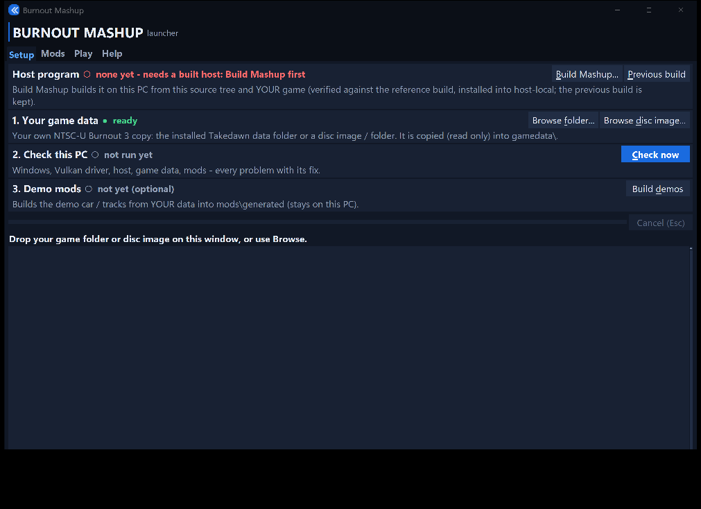
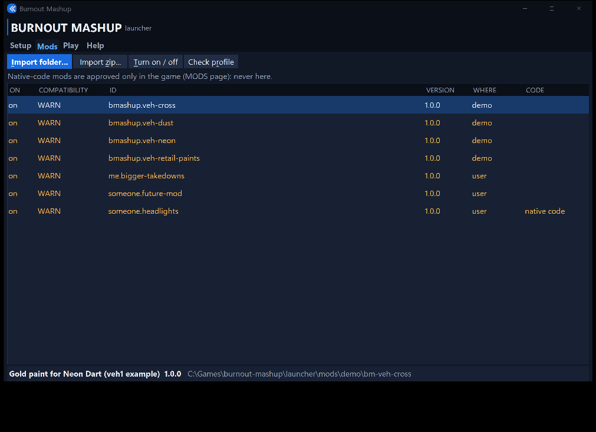
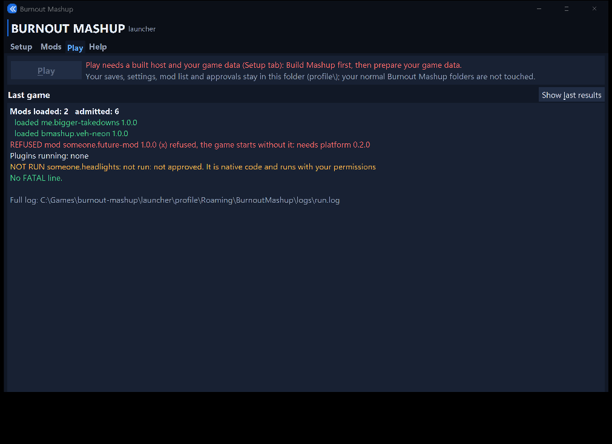
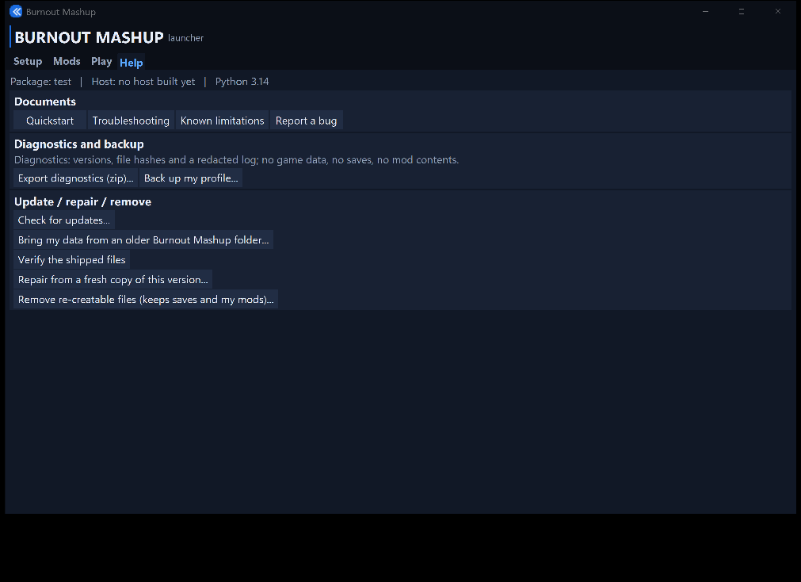

# Burnout Mashup - player quickstart (one page; source checkout, experimental alpha)

Experimental alpha: technically tested by the authors on one PC, **not** a release and **not** legally cleared (open questions:
`docs/PUBLIC_STATUS.md`). Unofficial fan project, not affiliated with Electronic Arts, Criterion Games, Microsoft or the Takedawn project.

You need: Windows 10/11 64-bit, a graphics driver with Vulkan 1.3, **Python 3.11 or newer** (python.org, tick
"Add python.exe to PATH"), and **your own** North American (NTSC-U) Xbox copy of Burnout 3: Takedown (an installed Takedawn data
folder, an extracted disc folder, its `default.xbe`, or a disc image). No game data and no host program come with Burnout Mashup:
the host is built on your PC from your own game (step 3), and what is built from your game stays on your PC (`docs/LOCAL_OUTPUTS.md`).

## 1. Get the source
Put this source tree into a **new folder of its own** (a git checkout or an unpacked source zip; keep line ends unchanged - the
repository's `.gitattributes` says `* -text`). Never put it inside a Takedawn folder. The path may contain spaces.

## 2. Open the launcher
Double-click **`launcher\Burnout Mashup.cmd`**. (A small starter exe can be built from `launcher\tools\launcher\exe`; it is not
shipped.) The window has four tabs (Ctrl+1 .. Ctrl+4).

## 3. Setup tab

1. **Your game data** - drag your game folder or disc image onto the window, or press *Browse folder...* / *Browse disc image...*.
   It is copied read-only into `gamedata\`; the source is never changed. *Cancel* (or Esc) stops it and keeps what was there before.
2. **Host program** - press **Build Mashup...**. It checks your game, offers the pinned build tools (each download needs your
   yes and is checked by sha256), fetches the pinned upstream source, builds the host in a build folder of your choice, verifies
   it against the reference build and only then installs it into `launcher\host-local`. It can be cancelled and resumed; a failed
   build leaves the previous working build in use (*Previous build* switches back). Details: `launcher\docs\BUILD_MASHUP.md`.
3. **Check this PC** - press *Check now*. Every problem is listed with what to do about it. It must end with **PASS**.
4. **Demo mods** (optional) - *Build demos* builds the demo car and tracks from your data (they stay on this PC).

## 4. Mods tab

- Every mod is listed with **on / off** and a compatibility verdict: **OK**, **WARN** (works, read the note) or **BLOCKED** (the
  game will refuse it: the reason says what to do). Before a host is built there is nothing to check against, so every mod
  shows WARN (as in the picture).
- *Import folder...* / *Import zip...* (or drop a mod on the window): you see what the mod is and what it contains **before**
  anything is copied. Nothing from a mod is ever run by the launcher.
- **Native-code mods** (plugins, `.asi`) run with your permissions. The launcher never approves them: the game asks you on its
  MODS page. Only approve mods you trust.

## 5. Play tab

**Play** is enabled only when Build Mashup has installed a verified host and your game data is ready. Your saves, settings, mod
list and approvals stay in `launcher\profile\`; a separate Takedawn install is never read or written. After a game the tab shows
which mods were admitted or refused (with the reason), which plugins ran, and whether anything went wrong.

## 6. Help tab, problems, updates

- *Troubleshooting*, *Known limitations*, *Report a bug* (where to send a report: `launcher\docs\BUGS_AND_CONTRIBUTING.md`).
- *Export diagnostics (zip)*: versions, file hashes and a redacted log (no game data, no saves, no mod contents). Read its file
  list before sending it. Never attach the host exe, game files, generated mods or saves.
- *Back up my profile*: copies your saves, settings and imported mods to a folder you choose (checked file by file).
- *Check for updates...*: contacts nothing until you press a step. This source tree ships with **no update channel and no trusted
  key**, so it says "No update channel configured"; nothing is checked automatically (`launcher\docs\UPDATES.md`).
- *Verify the shipped files* / *Repair from a fresh copy of this version...* / *Remove re-creatable files* (keeps your saves and
  imported mods). The same actions exist as `remove.cmd list | backup | upgrade | verify | repair | clean`.
